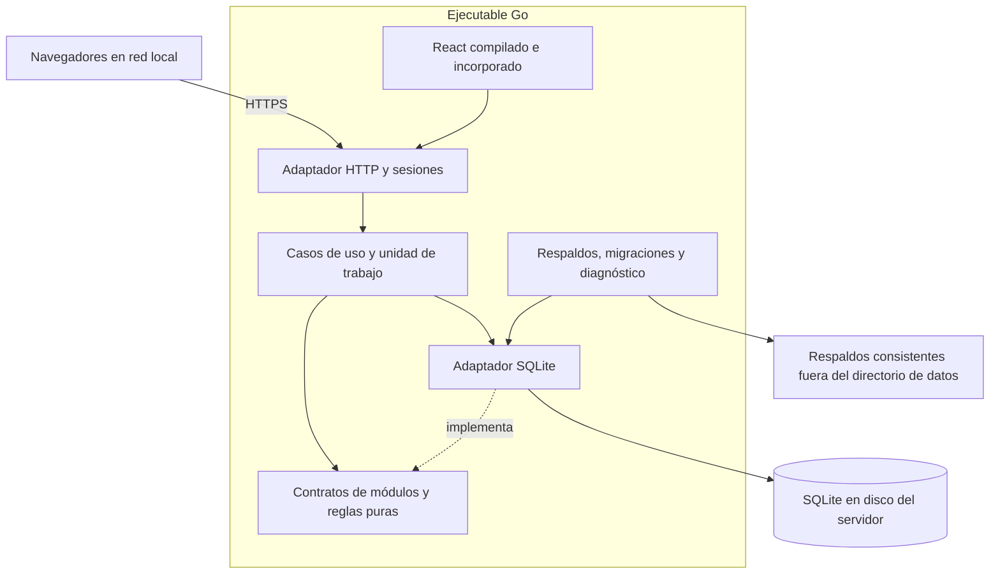

# Arquitectura y decisiones

## Contexto

El repositorio parte sin aplicación previa. La prioridad es operar en un equipo económico y distribuir actualizaciones sin instalar infraestructura adicional. Se adopta un **monolito modular**, un proceso y una base de datos por empresa. Objetivo de referencia: dos núcleos, 2 GiB de RAM, almacenamiento local y diez sesiones simultáneas. El hardware debe dimensionarse con datos representativos; esta cifra no constituye un límite de SQLite ni una garantía de capacidad.

## Organización y dependencias

- `cmd/erp`: composición, argumentos, ciclo de vida, señales y servicio nativo de Windows.
- `internal/core`: errores, identificadores aleatorios, paginación y aritmética exacta.
- `internal/modules`: modelos y puertos de administración, catálogo, inventario, promociones, ventas, tesorería, auditoría, periféricos de caja e informes; contratos de contactos y compras.
- `internal/pricing`: cálculo comercial puro, prioridades, regalos, descuentos exactos, consumos y huellas; no depende de HTTP ni SQLite.
- `internal/application`: casos de uso; coordina módulos mediante `Ports`, `Store.WithinTx` y `Store.ReadSnapshot` para cotizaciones consistentes.
- `internal/adapters/printing`: transporte RAW del spooler Windows y dispositivos USB Linux; enumeración, entrega y detección de resultados inciertos.
- `internal/adapters/sqlite`: repositorios y consultas SQL; implementa los puertos y provee una transacción compartida.
- `internal/transport/httpapi`: DTO, validación de transporte, permisos, sesiones, CSRF y respuestas.
- `internal/operations` y `platform`: configuración, certificados, respaldos, recuperación, bloqueos y sistema operativo.
- `web`: interfaz React. `internal/webui` incorpora el resultado compilado. `api` mantiene el contrato público y su generador.

Los módulos no importan el adaptador ni HTTP. Cada repositorio escribe las tablas de su módulo; el caso de uso comercial coordina los cambios. Las consultas de informes pueden unir tablas de varios módulos y son de solo lectura. No se accede a SQL desde controladores o componentes de interfaz.

## Decisiones adoptadas

| Decisión | Motivo y consecuencia |
| --- | --- |
| Go y HTTP estándar | Ejecutable independiente, conexiones y memoria limitables; sin runtime en producción. |
| React/TypeScript/Vite como SPA estática | Interfaz interactiva; Node participa únicamente en compilación. No hace falta renderizado de servidor para este ERP. |
| SQLite con controlador Go puro | Distribución sencilla para la carga inicial. Un escritor por base; transacciones breves e índices adecuados son necesarios. |
| Monolito modular y transacciones síncronas | Una venta tiene garantías atómicas sin coordinación distribuida. Los módulos pueden crecer sin multiplicar instalaciones. |
| Sesión persistente en servidor | Revocación al cerrar sesión o desactivar un usuario, sin almacenar credenciales en el navegador. |
| Importes enteros y cantidades fijas | Aritmética exacta y migración controlada entre motores. |
| HTTPS servido por el propio proceso | Acceso LAN protegido sin exigir un proxy adicional. HTTP se limita a direcciones loopback. |
| Respaldos con SQLite Online Backup API | Captura consistente de transacciones confirmadas incluso cuando hay contenido en WAL. |

Versiones directas fijadas en `go.mod` y `web/package-lock.json`. La versión SQLite incorporada por el controlador actual supera 3.51.3, que corrige el problema de reinicio de WAL. Las actualizaciones de dependencias deben repetir las pruebas de integridad y concurrencia.

## Seguridad y fallos

El alta exige conexión loopback y token aleatorio de 256 bits almacenado con permisos restringidos. Su consumo y la creación de empresa/administrador están protegidos por la unicidad del registro de empresa; el archivo del token se elimina al finalizar.

Contraseñas Argon2id con sal aleatoria, 64 MiB, una iteración y un hilo; el servidor limita a dos las verificaciones simultáneas. El acceso se limita a diez intentos por IP y minuto, con mapa acotado. Las sesiones duran doce horas y se almacenan por hash del token; cada escritura exige CSRF y se rechazan orígenes cruzados. La cookie es HttpOnly, SameSite=Strict y Secure en HTTPS. El proceso no confía en cabeceras de proxy para el alta o la IP de acceso.

El administrador edita productos/composiciones, ajusta inventario, administra promociones, empresa, usuarios y respaldos. El operador consulta datos operativos y confirma ventas; necesita habilitación expresa por usuario para descuentos manuales. Los administradores tienen ese permiso siempre. Las concesiones y revocaciones se auditan y se reevalúan al cotizar/confirmar. Desactivar una cuenta o cambiar su contraseña revoca todas sus sesiones. El cambio de contraseña exige la actual. No se permite desactivar la propia cuenta ni dejar la instalación sin administrador activo.

Las composiciones de un nivel reutilizan productos de stock propio como insumos. La venta conserva consumos por línea y agrupa salidas por insumo dentro de una transacción, incluidos los regalos. Las cuatro políticas de stock y los conteos generan movimientos trazables. Una cotización firma precios, reglas, composición y permiso; una venta confirmada se recupera por idempotencia antes de recalcular. Las instantáneas comerciales conservan el historial frente a cambios posteriores. Véase [Datos e integridad](DATA.md).

Cada petición recibe un identificador y un registro estructurado de método, ruta, estado y duración. No se registran contraseñas, cookies, token de instalación, cuerpos o parámetros de URL. Los errores internos quedan en el registro del servidor y la API devuelve un mensaje uniforme sin SQL ni detalles del sistema.

## Fuentes técnicas

- [Go embed](https://pkg.go.dev/embed)
- [SQLite: escenarios adecuados y concurrencia](https://sqlite.org/whentouse.html)
- [SQLite WAL](https://sqlite.org/wal.html)
- [SQLite Online Backup API](https://sqlite.org/backup.html)
- [modernc.org/sqlite](https://pkg.go.dev/modernc.org/sqlite)

## Efectos físicos de caja

La impresión es un efecto posterior al commit, con una cola persistente en la unidad de trabajo de la venta. No se inicia desde la respuesta del navegador. Un trabajador serializa los envíos y conserva la instantánea del destino/contenido. Los reintentos de venta recuperan el trabajo original y las copias son solicitudes explícitas sin apertura. No existe garantía de entrega física exactamente una vez: ante un envío parcial o caída se registra resultado incierto, se evita el reenvío automático y se permite una copia revisada por el usuario.

La primera integración utiliza una impresora de tickets ESC/POS USB en el servidor y un lector USB HID en el cliente. No requiere un agente adicional en cada navegador. El modelo concreto se valida con pruebas de ticket y cajón; impresión y apertura permanecen desactivadas hasta esa confirmación. Los códigos de producto se exportan como archivos y no dependen del transporte de tickets.

## Egresos de caja y efectos físicos

Tesorería conserva ingresos por ventas y egresos en un libro inmutable. El caso de uso verifica el permiso efectivo, recupera primero las solicitudes ya confirmadas y registra correlativo, saldos y auditoría en una transacción. El trabajo de cajón se crea en esa misma unidad de trabajo y se envía tras el commit. Sus fallos no alteran ni duplican el movimiento de efectivo.

Las contraseñas cortas o vacías se eligen al establecer cada credencial con aceptación explícita. Esto no cambia el mecanismo de autenticación: incluso el valor vacío se verifica mediante Argon2id y utiliza sesiones con CSRF. No existe un interruptor global que quite contraseñas a otras cuentas.
