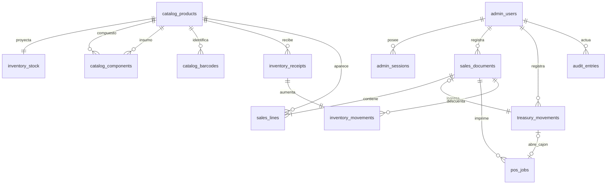
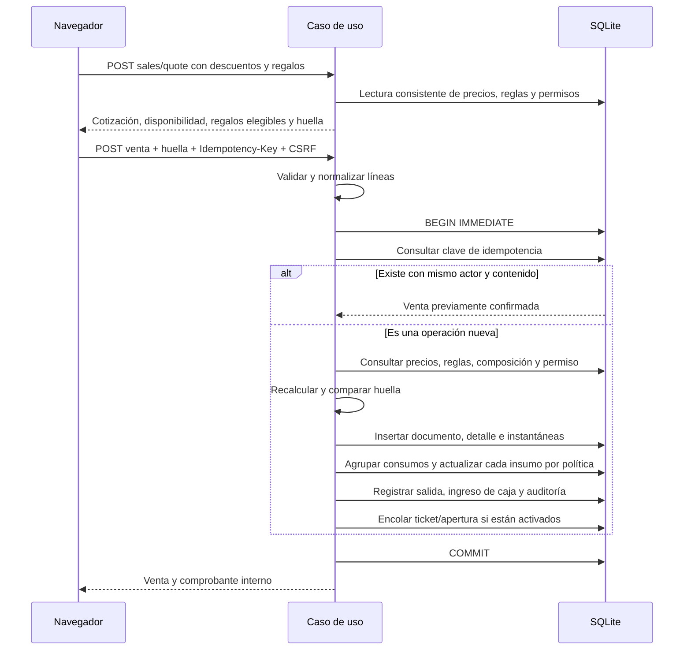

# Datos e integridad · esquema 4

## Convenciones

Una empresa por archivo de base de datos. No hay un identificador de inquilino ni filtros de aislamiento implícitos. Para atender dos empresas se ejecutan instalaciones con directorios y puertos distintos.

Los identificadores son 16 bytes aleatorios representados mediante 32 caracteres hexadecimales. Las fechas se guardan en UTC con precisión fija y se muestran en la zona horaria configurada. Cada venta tiene además un correlativo interno asignado por SQLite en la transacción; no es un folio tributario.

Los importes se guardan como `INTEGER` de 64 bits, en unidades menores de la moneda. La escala se fija al crear la empresa: CLP utiliza cero decimales; las otras monedas admitidas, dos. Los precios y totales individuales se acotan a 10^15 unidades menores. Se transportan como cadenas JSON para evitar la pérdida de precisión de JavaScript.

Las cantidades vendidas y los factores de composición se guardan en milésimas, con límite de 10^12. Admiten hasta tres decimales. Inventario, ingresos, ajustes y consumos usan millonésimas firmadas, hasta ±10^15. Por ejemplo, `0,25 × 0,125` consume exactamente `0.031250`, sin redondeo intermedio. Los porcentajes admiten dos decimales.

Cada línea se calcula con aritmética entera de precisión ampliada y redondeo de mitad hacia arriba; los descuentos globales se distribuyen por restos mayores con desempate estable por línea. Las líneas normales repetidas del mismo producto se consolidan. Cada línea tiene identificador propio; el mismo SKU puede aparecer además como regalo. Los algoritmos trabajan con cantidades agregadas, sin expandirlas unidad por unidad. El navegador controla la entrada con BigInt y muestra la cotización autoritativa del servidor.

## Relaciones principales

`catalog_products` conserva identidad, versión de edición, disponibilidad para venta, modo y política de stock. `catalog_components` contiene insumos y factores de un solo nivel. Se rechazan ciclos, autorreferencias, componentes compuestos y cambios de unidad con historial o uso como insumo/oferta por cantidad.

`inventory_stock` es una proyección para validar disponibilidad. `inventory_movements` conserva ingresos, salidas, ajustes por conteo y compensaciones de mínimo cero. Los compuestos no tienen stock vendible propio. La API devuelve `stock: null` para compuestos o sin seguimiento; cero representa un saldo controlado de cero. `availableQuantity` indica capacidad vendible según los insumos que bloquean faltantes; `null` significa que no existe un límite por stock. La cotización comprueba además el consumo compartido del carrito.

`promotion_rules` guarda reglas versionadas. `sales_documents.details_json` conserva precios, nombres, promociones, descuentos solicitados/aplicados, motivos, responsables y consumos por línea; `company_json` conserva la empresa del comprobante. Editar el catálogo, reglas o empresa no altera estos registros. `treasury_movements` conserva un único ingreso por venta por su importe final y egresos independientes con importe firmado negativo. Cada egreso guarda correlativo propio, motivo, actor y nombre, saldos anterior/final, clave/hash de idempotencia y trabajo de cajón asociado. Las columnas de venta son opcionales para egresos; las restricciones distinguen ambos tipos. El saldo de caja es ingresos menos egresos; facturación y ventas no se reducen por estos gastos. Los movimientos y auditoría tienen disparadores que rechazan modificaciones o eliminaciones. La auditoría contiene detalles estructurados de ajustes y cambios de permisos.

Las tablas son STRICT. Las claves foráneas se habilitan en cada conexión, las existencias tienen restricciones de rango y el ingreso de caja referencia una venta única. La auditoría admite actores de consola local sin exigir una cuenta de usuario para esas operaciones de recuperación.

`catalog_barcodes` contiene identidades de texto únicas entre productos, con formato, origen generado/externo y un principal por producto. Los ceros iniciales se conservan y los códigos no dependen del SKU. Un producto tiene como máximo un código interno generado, recuperable idempotentemente y asignado dentro de la misma unidad de trabajo que su versión y auditoría.

Los eventos nuevos añaden actor, referencia legible, descripción y entidad relacionada como instantáneas. El catálogo central de operaciones proporciona etiquetas y búsqueda en español. Los eventos antiguos se enriquecen para consulta sin modificar la auditoría original, indicando qué datos históricos faltan. La búsqueda de operación no consulta claves internas del JSON ni datos de otras columnas.

`pos_settings` guarda el perfil versionado y sus verificaciones físicas. `pos_jobs` conserva destino, bytes del ticket, intención de apertura, clave/hash de idempotencia, estado y resultado; los bytes y datos internos de envío no se exponen por HTTP. Cada venta automática tiene un único trabajo, enlazado por `sales_documents.print_job_id` y la instantánea del documento. Reimpresiones y aperturas manuales son solicitudes separadas y auditadas. Los egresos habilitados encolan `expense_drawer`, con relación única al movimiento y solo los bytes del pulso. Movimiento, auditoría y trabajo se confirman juntos; ningún reintento crea otra apertura. Si se desactiva el cajón o cambia el dispositivo antes del envío, el trabajo se suspende.

## Confirmación de venta

El trabajador de impresión reclama una tarea por transacción y libera SQLite antes de contactar con el equipo. Los trabajos se serializan. Una entrega posiblemente parcial termina en `uncertain`, sin reenvío automático; un proceso interrumpido mientras enviaba se recupera con ese mismo estado. `sent` significa aceptación por dispositivo/spooler, sin garantizar salida física. Un fallo de impresión conserva la venta. Las copias no contienen el pulso de apertura.

Ante faltantes en productos con política de bloqueo, una restricción o un fallo, se revierte la transacción completa. Cada insumo se actualiza una sola vez por venta. Permitir negativos conserva el consumo; mínimo cero registra salida completa y compensación; sin seguimiento omite la modificación del saldo. La espera por contención se limita a cinco segundos y se convierte en error recuperable 503.

La huella incluye datos comerciales, versiones y permiso efectivo. El tiempo selecciona reglas vigentes, sin firmar cada instante del reloj. Se reevalúan precios, reglas, composición y permiso al confirmar; si cambiaron, se exige revisión (409). Los saldos se verifican en la transacción sin invalidar una huella solo porque otra venta modificó existencias.

La clave de idempotencia queda en el documento de venta, junto con el hash del actor y del cuerpo normalizado, excluyendo la huella. Se busca antes de volver a evaluar ofertas o descuentos: una venta confirmada devuelve su resultado original aunque la promoción haya expirado o el permiso cambie. Su retención es la del documento. La misma clave con contenido diferente produce 409. Repetir una venta confirmada responde 200 y `Idempotency-Replayed: true`; una venta nueva responde 201.

El cliente conserva carrito, descuentos, regalos, cotización y clave en sessionStorage por usuario. Si pierde la respuesta después de enviar, congela el carrito y permite repetir exactamente la operación; la recarga y el cambio de usuario en la misma pestaña conservan ese estado.

## Consultas y migraciones

Las listas devuelven `items`, `total`, `page` y `pageSize`, con un máximo de cien elementos. Las búsquedas usan parámetros y escapan comodines. Los índices cubren SKU, nombre, fechas, claves de idempotencia y relaciones de movimientos. Una búsqueda parcial puede requerir recorrer el catálogo; antes de introducir búsqueda especializada debe medirse con datos reales.

Cada migración SQL está incorporada en el ejecutable. `PRAGMA user_version` identifica la compatibilidad y `schema_migrations` conserva la versión aplicada. El servidor rechaza bases de una versión superior. La migración se ejecuta bajo el bloqueo de instalación y dentro de una transacción, con respaldo previo para bases existentes.

El paso 1 → 2 multiplica por 1000 las cantidades históricas de inventario al pasar a millonésimas. Los productos existentes conservan stock propio, bloqueo de faltantes y disponibilidad para venta. Las ventas antiguas mantienen correlativos, precios, cantidades, claves y hashes; sus descuentos son cero. Se asignan identificadores a las líneas y se recuperan reintentos antiguos ya confirmados sin exigir huella.

La migración 2 → 3 añade códigos, instantáneas de auditoría, configuración y cola de periféricos sin modificar importes, cantidades, ventas, correlativos ni claves existentes. La impresión empieza desactivada. Las solicitudes antiguas confirmadas conservan su recuperación original y no generan trabajos nuevos.

La migración 3 → 4 conserva los ingresos y trabajos de periféricos existentes al ampliar el libro de caja y añadir el permiso de egresos. Los operadores existentes empiezan sin ese permiso; los administradores siempre lo tienen. No se cambian credenciales existentes.

La versión 0.4 restaura respaldos de esquema 4. Para una copia de esquema 1, 2 o 3, restaura primero con su ejecutable compatible (0.1, 0.2 o 0.3) y luego actualiza. Una restauración suspende trabajos pendientes/enviándose y desactiva/verifica de nuevo los periféricos para evitar salidas físicas repetidas. No hay migraciones descendentes. Véase [Operación y recuperación](OPERATIONS.md).
